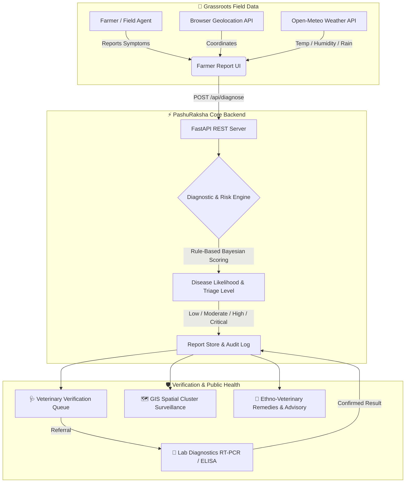

# 🐄 PashuRaksha AI (पशुरक्षा AI)

### *AI-Assisted Livestock Health Early-Warning & Outbreak Surveillance Platform*

[](https://fastapi.tiangolo.com/)
[](https://www.typescriptlang.org/)
[](https://vitejs.dev/)
[](https://www.python.org/)
[](https://www.sih.gov.in/)
[](LICENSE)

---

## 📌 Overview

**PashuRaksha AI** is an end-to-end livestock disease surveillance and early-warning platform designed for the **Smart India Hackathon 2026** (**Problem Statement: SIH26128**).

It bridges the gap between grassroots livestock observations and centralized veterinary response. By combining **automatic geolocation**, **real-time environmental context (weather, humidity, heat-index)**, and **structured clinical symptom reporting**, PashuRaksha AI computes a probabilistic **Livestock Health Risk Indication**, routes cases through human-in-the-loop **Veterinary Verification** and **Laboratory Confirmation**, and plots real-time spatial clusters on an interactive **GIS Surveillance Heatmap**.

> **Note on Medical Governance:** PashuRaksha AI is an intelligent decision-support and surveillance system. It provides early risk alerts and triage recommendations to assist veterinarians and livestock authorities; it does not replace licensed veterinary diagnosis.

---

## 🌟 Key Features

| Feature | Description |
| :--- | :--- |
| **📍 Automatic Geolocation & Weather Context** | Auto-detects device GPS, performs reverse-geocoding (District/State/Pincode), and fetches ambient temperature, humidity, rainfall, and wind-speed in real time via Open-Meteo. |
| **🧠 Multi-Factor Risk Assessment Engine** | Evaluates species, body temperature, clinical symptoms (e.g., skin nodules, mucosal lesions, salivation), and environmental vectors to compute disease match probabilities (Lumpy Skin Disease, FMD, Anthrax, Hemorrhagic Septicemia, Black Quarter, etc.). |
| **🩺 Veterinary Verification Queue** | Field veterinarians inspect flagged alerts, verify farmer observations, prescribe quarantine/containment protocols, or order diagnostic testing. |
| **🔬 Laboratory Sample & Results Workflow** | Tracks sample collection (blood, nasal swabs, skin scrapings), sample transit, and lab RT-PCR/ELISA confirmation results back to individual case IDs. |
| **🗺️ Real-Time GIS Outbreak Surveillance** | Interactive geospatial mapping with cluster detection that flags emerging disease hotspots before they turn into widespread epidemics. |
| **🌿 Prevention & Ethno-Veterinary Medicine (EVM)** | Curated repository of NDDB / ICAR-tested herbal formulations, bio-security measures, and National Animal Disease Control Programme (NADCP) vaccination schedules. |
| **📶 Offline-First Resilient Architecture** | In areas with zero or spotty rural cellular coverage, reports are stored locally in an IndexedDB/LocalStorage queue and automatically synchronized once connectivity is restored. |

---

## 🏛️ System Architecture



---

## 📂 Project Structure

```
pashuraksha-ai/
├── start_all.bat               # Windows batch launcher (runs Backend + Frontend)
├── start_all.ps1               # PowerShell launcher with port auto-detection
├── pashuraksha-ai/
│   ├── backend/
│   │   ├── app/
│   │   │   ├── main.py          # FastAPI application & API routers
│   │   │   ├── models.py        # Pydantic schemas for reports & risk payload
│   │   │   ├── data.py          # Disease matrices, EVM formulations, vaccines
│   │   │   └── services/
│   │   │       └── diagnostic_engine.py # Bayesian symptom evaluation engine
│   │   ├── test_suite.py        # 9 automated tests for risk scoring & endpoints
│   │   └── requirements.txt     # Python dependencies
│   │
│   ├── frontend/
│   │   ├── index.html           # Main dashboard interface
│   │   ├── app.ts               # Core application logic & UI controllers
│   │   ├── app.js               # Production ES2020 bundle
│   │   ├── package.json         # Vite build configuration
│   │   └── tsconfig.json        # TypeScript configuration
│   │
│   ├── application photos/      # UI screenshots and demonstration captures
│   └── README_REPORT.md         # Full project technical evaluation report
└── README.md                    # Root project documentation
```

---

## 🚀 Quick Start Guide

### Option 1: One-Click Startup (Windows)

Double click `start_all.bat` or run in PowerShell:
```powershell
.\start_all.ps1
```
This automatically boots:
- **FastAPI Backend** on `http://127.0.0.1:8000`
- **Frontend Dashboard** on `http://127.0.0.1:3000`

---

### Option 2: Manual Setup

#### 1. Backend (Python & FastAPI)
```bash
# Navigate to backend directory
cd pashuraksha-ai/backend

# Create virtual environment & activate
python -m venv .venv
# Windows:
.venv\Scripts\activate
# Linux/macOS:
# source .venv/bin/activate

# Install dependencies
pip install -r requirements.txt

# Run the FastAPI server
python -m uvicorn app.main:app --host 127.0.0.1 --port 8000 --reload
```
- Interactive Swagger UI: [http://localhost:8000/docs](http://localhost:8000/docs)
- OpenAPI JSON: [http://localhost:8000/openapi.json](http://localhost:8000/openapi.json)

#### 2. Frontend (Vite & TypeScript)
```bash
# In a separate terminal, navigate to frontend
cd pashuraksha-ai/frontend

# Install dependencies
npm install

# Start development server
npm run dev -- --port 3000 --host 127.0.0.1
```
- Access application: [http://localhost:3000](http://localhost:3000)

---

## 🧪 Running Automated Tests

A dedicated test suite validates the diagnostic engine, risk indicator levels, fever scoring, weather data injection, and API models:

```bash
cd pashuraksha-ai/backend
python test_suite.py
```

Expected output:
```text
Ran 9 tests in 0.64s
OK (All 9 Unit & Integration Tests Passed)
```

---

## 📸 Screenshots & Workflow

| 1. Farmer Report & Environmental Sensor Context | 2. Real-Time GIS Outbreak Surveillance |
| :---: | :---: |
|  |  |

| 3. Veterinary Verification Queue | 4. Lab Confirmation Workflow |
| :---: | :---: |
|  |  |

| 5. Disease Matrix & Knowledge Base | 6. Ethno-Veterinary Remedies & Biosecurity |
| :---: | :---: |
|  |  |

---

## 🌐 Key API Endpoints

| Method | Endpoint | Description |
| :--- | :--- | :--- |
| `POST` | `/api/diagnose` | Core AI triage: Accepts animal profile, temperature, and symptom flags to calculate disease risks, quarantine urgency, and containment recommendations. |
| `GET` | `/api/health` | Healthcheck and active system status probe. |
| `GET` | `/api/diseases` | Comprehensive disease master catalog with incubation periods and transmission vectors. |
| `GET` | `/api/evm-remedies` | NDDB & ICAR validated herbal preparations and dosage guidelines. |
| `GET` | `/api/vaccination-schedule` | National Animal Disease Control Programme (NADCP) vaccination calendar. |
| `GET` | `/api/reports` | Fetches active surveillance reports for veterinary audit and GIS mapping. |

---

## 👥 Team & Institution

- **Event:** Smart India Hackathon 2026
- **Problem Statement ID:** SIH26128
- **Team Name:** Tech Titans
- **Institution:** Don Bosco Institute of Technology (DBIT), Bengaluru

---

## 📄 License

This project is licensed under the [MIT License](LICENSE) - feel free to use and adapt for academic and public animal health surveillance research.
